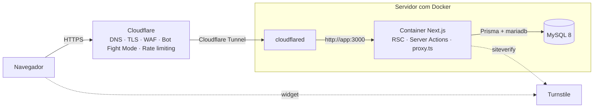
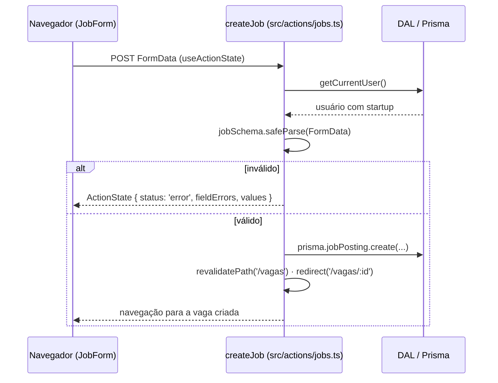

# Arquitetura

## Visão geral

O Synergy é um **monólito fullstack em Next.js**: as páginas (React Server Components), as mutações
(Server Actions) e o acesso ao banco (Prisma) vivem no mesmo projeto e no mesmo container. Em produção o
tráfego entra pela Cloudflare e chega ao container por um túnel de saída, sem expor portas no servidor.

## Camadas do código

| Camada            | Pasta                 | Responsabilidade                                                                                                 |
| ----------------- | --------------------- | ---------------------------------------------------------------------------------------------------------------- |
| Rotas e páginas   | `src/app`             | Server Components que buscam dados e renderizam a UI. Formulários são Client Components pequenos                 |
| Mutações          | `src/actions`         | Server Actions (`'use server'`). Toda escrita no banco passa por aqui, com autenticação, autorização e validação |
| Consultas         | `src/lib/data`        | Funções de leitura reutilizadas pelas páginas (selects explícitos, nunca `passwordHash`)                         |
| Validação         | `src/lib/validations` | Schemas Zod compartilhados por formulários e actions                                                             |
| Autenticação      | `src/lib/auth`        | Token JWT (`token.ts`), cookie (`session.ts`), senha (`password.ts`) e DAL (`dal.ts`)                            |
| Regras de negócio | `src/lib/plan.ts`     | Premium e prioridade de inscrição — funções puras com testes unitários                                           |
| UI                | `src/components`      | `ui/` (primitivos), `layout/`, e componentes por domínio (`events/`, `jobs/`, ...)                               |
| Banco             | `prisma/`             | `schema.prisma` (fonte da verdade), migrações SQL versionadas e `seed.ts`                                        |

Convenção de nomes: **código em inglês** (tabelas, variáveis, funções) e **textos da interface em português**
(`src/lib/labels.ts` traduz os enums do banco).

## Fluxo de uma requisição

1. `src/proxy.ts` roda antes das rotas `/app/*`, `/login` e `/cadastro`: faz uma verificação **otimista**
   do cookie de sessão e redireciona cedo (sem ir ao banco).
2. O layout raiz chama `getCurrentUser()` para montar o cabeçalho. A função é memoizada por requisição
   (`React.cache`), então as páginas reutilizam o resultado sem consultas extras.
3. Páginas protegidas chamam `requireUser()`, `requireRole()` ou `requirePremium()` (DAL). Essa é a
   verificação **definitiva** — o proxy nunca é a única barreira.
4. Como o layout lê cookies, todas as páginas são renderizadas dinamicamente a cada requisição
   (nada fica em cache estático), o que também evita acesso ao banco durante o `next build`.

## Fluxo de uma Server Action (ex.: publicar vaga)

Todas as actions seguem o mesmo contrato (`ActionState` em `src/lib/action-state.ts`): autenticam, validam
com Zod, checam **propriedade** (a startup só edita as próprias vagas; autor ou admin excluem posts) e
devolvem mensagens amigáveis em português. Erros de validação repopulam o formulário.

## Autenticação e autorização

- **Senhas** com bcrypt (custo 12). No login a comparação acontece mesmo quando o e-mail não existe, para
  não revelar contas pelo tempo de resposta.
- **Sessão** stateless: JWT HS256 assinado com `SESSION_SECRET` (≥ 32 caracteres), guardado em cookie
  `HttpOnly`, `SameSite=Lax`, `Secure` em produção, validade de 7 dias. O payload carrega apenas `sub`
  (id do usuário) e `role`; dados do usuário (plano, perfis) vêm sempre do banco.
- **Autorização** por perfil (`Role`) e por plano (`Plan`). `hasPremium()` libera admins automaticamente.
- **Proteção contra abuso**: limitador em memória para login/cadastro (`src/lib/rate-limit.ts`), Turnstile
  opcional nos formulários e, na borda, rate limiting e Bot Fight Mode da Cloudflare (ver `docs/deploy.md`).
- **Cabeçalhos de segurança** em `next.config.ts` (`nosniff`, `X-Frame-Options`, `Referrer-Policy`,
  `Permissions-Policy`, HSTS). O Next.js ainda aplica verificação de `Origin` (CSRF) nas Server Actions.

## Regras de negócio centrais

| Regra                                                            | Onde                                          | Teste                                |
| ---------------------------------------------------------------- | --------------------------------------------- | ------------------------------------ |
| Comunidade, roadmap e templates só para Premium                  | `hasPremium`, `requirePremium`, `PremiumGate` | `src/lib/plan.test.ts`               |
| Investidores confirmam presença publicamente, sem limite         | `canRegisterForEvent`                         | `src/lib/plan.test.ts`               |
| Janela de prioridade: só Premium se inscreve até `priorityUntil` | `canRegisterForEvent`                         | `src/lib/plan.test.ts`               |
| Capacidade do evento                                             | `canRegisterForEvent`                         | `src/lib/plan.test.ts`               |
| Datas digitadas são horário de Brasília                          | `parseDateTimeLocal`                          | `src/lib/validations/events.test.ts` |

## Decisões técnicas (resumo das ADRs)

1. **Next.js fullstack em vez de Django + React separados** — um único repositório, uma linguagem
   (TypeScript) para front e back, deploy de um container só e menos integração a manter. O time
   continua com React no front, como planejado.
2. **MySQL 8** — mantido conforme o planejamento da equipe (modelagem em DBML/dbdiagram.io).
3. **Prisma 7** — schema declarativo próximo do DBML, migrações SQL versionadas e cliente tipado.
   No Prisma 7 a URL do banco fica em `prisma.config.ts` e o cliente usa um _driver adapter_
   (`@prisma/adapter-mariadb`, compatível com MySQL). O pacote `mariadb` é fixado em versão corrigida
   via `overrides` no `package.json`.
4. **Autenticação própria seguindo o guia oficial do Next.js** — menos dependências e um fluxo
   transparente para aprendizado. Se o produto precisar de login social, recuperação de senha por e-mail
   ou 2FA, migrar para Auth.js ou Better Auth é um passo natural (ver roadmap).
5. **Server Actions em vez de API REST** — menos código de integração; a segurança é tratada em cada
   action. Se surgir um cliente externo (app mobile), expor Route Handlers em `src/app/api`.
6. **Tailwind sem biblioteca de componentes** — primitivos próprios e simples em `src/components/ui`.
   A equipe pode adotar shadcn/ui depois sem reescrever páginas.
7. **Cloudflare Tunnel em vez de portas abertas** — o servidor não expõe 80/443; WAF e proteção contra
   bots não podem ser contornados acessando o IP de origem diretamente.

## Limitações conhecidas

- Upgrade Premium é **simulado** (não há cobrança). Integração com gateway de pagamento está no backlog.
- O limitador de requisições é em memória: funciona para uma instância. Com várias réplicas, usar Redis
  ou confiar apenas no rate limiting da Cloudflare.
- Não há envio de e-mails (confirmação de conta, recuperação de senha).
- Sem CSP (Content Security Policy) estrita ainda — exige nonces nos scripts do Next.js.
