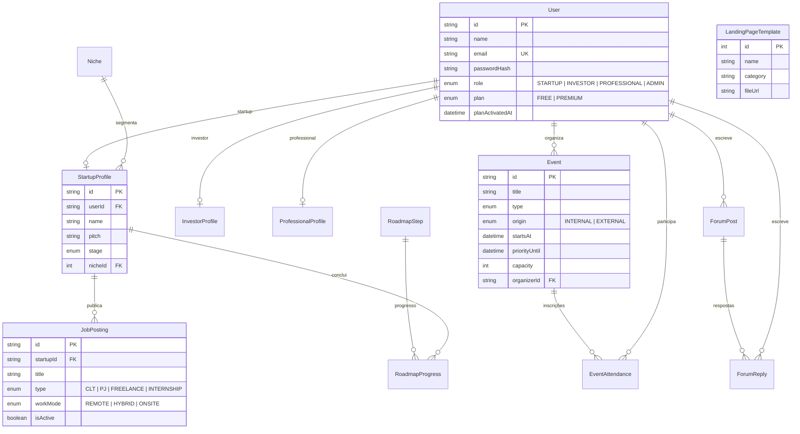

# Banco de dados

MySQL 8 com Prisma 7. A fonte da verdade é `prisma/schema.prisma`; cada alteração gera uma migração SQL
versionada em `prisma/migrations`. O arquivo [`banco-de-dados.dbml`](banco-de-dados.dbml) pode ser colado no
[dbdiagram.io](https://dbdiagram.io) para visualizar o diagrama.

## Diagrama



## Tabelas

| Tabela                     | Finalidade                                                                                                   |
| -------------------------- | ------------------------------------------------------------------------------------------------------------ |
| `User`                     | Conta de acesso: e-mail único, hash da senha, perfil (`role`) e plano (`plan`). Nunca exponha `passwordHash` |
| `Niche`                    | Nichos de mercado (fintech, healthtech...). Carregados pelo seed; usados para segmentar startups             |
| `StartupProfile`           | Dados da startup (1:1 com `User` de perfil STARTUP): nome, pitch, estágio, nicho, cidade, site               |
| `InvestorProfile`          | Dados do investidor anjo: empresa/fundo, tese, faixa de ticket, LinkedIn                                     |
| `ProfessionalProfile`      | Dados do profissional: título, bio, habilidades, links, disponibilidade para freelance                       |
| `Event`                    | Eventos internos ou externos: datas, local/online, capacidade, `priorityUntil` (janela Premium)              |
| `EventAttendance`          | Inscrição/presença (única por evento + usuário). Para investidores, é a presença pública                     |
| `JobPosting`               | Vagas publicadas por startups: tipo, modelo de trabalho, faixa salarial, habilidades, ativa/inativa          |
| `ForumPost` / `ForumReply` | Comunidade (Premium): publicações e respostas com autor                                                      |
| `RoadmapStep`              | Passos do roadmap burocrático agrupados por fase (seed)                                                      |
| `RoadmapProgress`          | Passos concluídos por startup (único por startup + passo)                                                    |
| `LandingPageTemplate`      | Catálogo de templates (arquivos em `public/templates`)                                                       |

### Enums

| Enum           | Valores                                                             |
| -------------- | ------------------------------------------------------------------- |
| `Role`         | `STARTUP`, `INVESTOR`, `PROFESSIONAL`, `ADMIN`                      |
| `Plan`         | `FREE`, `PREMIUM`                                                   |
| `StartupStage` | `IDEA`, `VALIDATION`, `MVP`, `TRACTION`, `SCALE`                    |
| `EventType`    | `HACKATHON`, `MEETUP`, `PITCH_DAY`, `WORKSHOP`, `DEMO_DAY`, `OTHER` |
| `EventOrigin`  | `INTERNAL`, `EXTERNAL`                                              |
| `JobType`      | `CLT`, `PJ`, `FREELANCE`, `INTERNSHIP`                              |
| `WorkMode`     | `REMOTE`, `HYBRID`, `ONSITE`                                        |

Os rótulos em português de cada valor ficam em `src/lib/labels.ts`.

## Convenções

- Chaves primárias `cuid()` (texto) nas entidades de negócio; `autoincrement` em tabelas de catálogo
  (`Niche`, `RoadmapStep`, `LandingPageTemplate`).
- `createdAt`/`updatedAt` em todas as entidades editáveis.
- Exclusão em cascata de perfis, inscrições, vagas, respostas e progresso quando o pai é removido.
- Textos longos usam `@db.Text`; o restante é `VARCHAR(191)` (padrão do Prisma para MySQL com utf8mb4).
- Datas são armazenadas em UTC. Entradas de formulário são interpretadas como horário de Brasília
  (`parseDateTimeLocal`) e exibidas com `Intl` em `America/Sao_Paulo` (`src/lib/format.ts`).

## Como alterar o modelo

```bash
# 1. Edite prisma/schema.prisma
# 2. Gere e aplique a migração no banco local (também regenera o Prisma Client)
npm run db:migrate -- --name adiciona_campo_x
# 3. Commite a pasta prisma/migrations/<timestamp>_adiciona_campo_x junto com o código
# 4. Atualize este documento e o DBML
```

Em produção o container executa `prisma migrate deploy` ao iniciar, aplicando apenas as migrações pendentes.
Nunca edite uma migração já aplicada em produção: crie uma nova.

## Dicas

- `npm run db:studio` abre o Prisma Studio para inspecionar e editar dados.
- `npm run db:reset` apaga o banco local, reaplica as migrações e roda o seed.
- Em desenvolvimento a `DATABASE_URL` usa o usuário `root` porque o `migrate dev` cria um _shadow database_
  temporário. Em produção use o usuário restrito (`synergy`).
